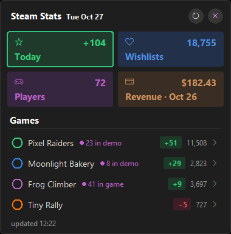
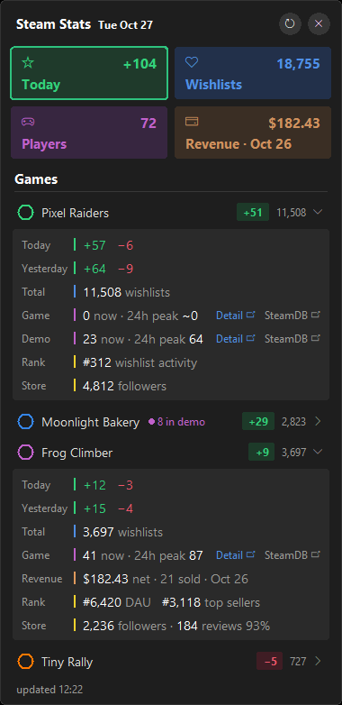

# Steam Data PC Widget

A small always-available Windows desktop widget for Steam developers. It shows your **daily and total wishlists**, **current players** and **24-hour peak** for your games and demos, and **recent revenue**, all pulled from the official Steamworks APIs. No browser, no dashboards to open.

<table>
  <tr>
    <td align="center"></td>
    <td align="center"></td>
  </tr>
  <tr>
    <td align="center"><sub>Collapsed overview</sub></td>
    <td align="center"><sub>Game details expanded</sub></td>
  </tr>
</table>

> [!NOTE]
> The games and data shown in these screenshots are fictional and for preview purposes only. They do not represent real games, wishlists, player counts or revenue.

---

## Features

- **Summary tiles**: wishlists added today, total outstanding wishlists, players online right now, and latest revenue across all your games.
- **Automatic game discovery**: every game and demo on your Steamworks account is found automatically. Demos are paired with their full game.
- **Sorted by momentum**: the game that received the most wishlists today is always at the top.
- **Collapsible rows**: each game is a single compact row. Click it to expand the details:
  - Today / Yesterday: wishlist adds (green) and deletes (red)
  - Total outstanding wishlists
  - Current players and 24h peak for the game and its demo
  - Net revenue and units sold
  - Steam store ranks: daily active users (DAU), top sellers and wishlist activity
  - Followers, plus review count and positive percentage
- **Live player hint**: when a row is collapsed and someone is playing, a small purple badge shows it (`● 3 in game · 12 in demo`).
- **One-click links** on every game and demo row:
  - **Detail** opens the app's Steamworks *Sales & Activations* details page, where the median playtime and lifetime stats live
  - **SteamDB** opens the SteamDB player chart
- **Hourly refresh** aligned to the clock (13:00, 14:00, …), plus a manual refresh button that also picks up newly added games and demos.
- **Configurable day boundary**: by default the day rolls over at 10:00 local time in Türkiye, which is midnight Pacific in summer, matching Steam's own reporting day.
- **Resilient**: when Steam is down or you are offline, the last known numbers stay on screen with a small warning.
- **Lightweight**: a single Python file that uses only the standard library (tkinter). No pip installs.
- Frameless, draggable, rounded dark UI inspired by GNOME / libadwaita. Optional *always on top* and *start with Windows*.

---

## Requirements

- Windows 10 or 11
- Python 3 with tkinter. The standard python.org installer includes tkinter. It has been tested on Python 3.14. `install.bat` can install Python for you through `winget`.
- A Steamworks partner account with access to:
  - a **Financial API key** for wishlists and revenue
  - a **Publisher Web API key** for automatic game discovery and players of unreleased apps

---

## Quick start

1. Download or clone this repository into a permanent folder, for example `Documents\Steam-Data-PC-Widget`.

   > Do not leave it in *Downloads* or a temporary folder. The startup shortcut points to this exact location.

2. Double-click **`install.bat`**. It will:
   - find Python, or install it with `winget` if it is missing. After a fresh Python install, run `install.bat` once more.
   - create `config.json` from `config.example.json` and open it in Notepad
   - add the widget to Windows startup
   - start the widget

3. Paste your two API keys into `config.json` (see [Getting your API keys](#getting-your-api-keys)) and save it. Then right-click the widget, choose **Close**, and run `start.bat`. Settings are read only when the widget starts.

The first run downloads your full wishlist history once (see [First run](#first-run-and-caching)). After that, every refresh takes a few seconds.

### Manual start

```bash
pythonw steam_widget.py
```

Or double-click `start.bat`.

---

## Getting your API keys

The widget uses two Steamworks Web API keys:

| Key | Used for | Goes into |
|---|---|---|
| **Financial API key** | Wishlists and revenue | `financial_api_key` |
| **Publisher Web API key** | Finding your games and demos automatically, and player counts of unreleased apps | `publisher_api_key` |

Two keys are needed because a Financial API key is not linked to any apps, so it cannot list your games. A publisher key, in turn, cannot read financial data.

### Before you start

- You need **administrator** rights on your Steamworks partner account. If you are not an admin, the admins are listed on the right side of your Steamworks home page. Ask one of them to create the keys or to make you an admin.
- Both keys are created on the same page: sign in at [partner.steamgames.com](https://partner.steamgames.com), open **Users & Permissions** in the top menu, and choose **Manage Groups**.

### 1. Financial API key (wishlists and revenue)

1. Go to **Users & Permissions → Manage Groups**.
2. Create a new **Financial API Group**. You can name it anything, for example `Financial API`. This special group has **no users and no apps**. That is expected.
3. Open the new group's page. Steam shows the group's **Financial Web API key** there. If the page asks you to create a key first, use **Create WebAPI Key** and make sure the key has financial access.
4. Optional but recommended: in the **Manage WebAPI Key** section of the same page, add the IP addresses of the PCs that will run the widget. Requests from other IPs will then be rejected.
5. Copy the key into `financial_api_key` in `config.json`.

This key can read **all sales data for every app on your partner account**. Treat it like a password: do not email it, do not share it, and never commit it.

Steamworks documentation: [IPartnerFinancialsService](https://partner.steamgames.com/doc/webapi/IPartnerFinancialsService)

### 2. Publisher Web API key (game discovery)

1. Go to **Users & Permissions → Manage Groups**.
2. Open a group that **has your games attached**, or create a new group and add your games and demos to it. Steam recommends a dedicated group just for Web API access.
3. Check that the list of applications in the group is correct. The key only sees the apps in its group, so a game or demo that is not in the group will not appear in the widget.
4. Click **Create WebAPI Key**.
5. Choose the key's permissions. The widget only reads your app list and player counts, so **General API calls** should be enough. It does not need *Microtransactions*, *Sales Data* or *Economy*.
6. Click **Save Changes**. The new key appears in the right-hand sidebar of the group's page.
7. Optional: restrict the key to your IP addresses, as with the Financial key.
8. Copy the key into `publisher_api_key` in `config.json`.

Steamworks documentation: [Web API authentication and publisher keys](https://partner.steamgames.com/doc/webapi_overview/auth)

### 3. Check that the keys work

Open PowerShell and run the two commands below. Replace `YOUR_KEY` with the key, and do not share the output.

```powershell
curl.exe "https://partner.steam-api.com/IPartnerFinancialsService/GetChangedDatesForPartner/v001/?key=YOUR_KEY&highwatermark=0"
```

With a working **Financial** key this returns something like `{"response":{"dates":["2026/10/11", ...],"result_highwatermark":"..."}}`. If you have no sales yet, the list can be empty.

```powershell
curl.exe "https://partner.steam-api.com/ISteamApps/GetPartnerAppListForWebAPIKey/v2/?key=YOUR_KEY"
```

With a working **publisher** key this returns your apps with their `appid`, `app_type` and `app_name`. If the list is empty (`[null]`), the key's group has no apps attached. This is also what you get if you accidentally use the Financial key here.

A `403 Forbidden` response means the key is wrong, lacks permission, or your IP is not on the key's allow list.

### Without a publisher key

If you prefer not to create a publisher key, list your games manually in `config.json`:

```json
"games": [
  {"name": "My Game", "appid": 1234560, "demo_appid": 1234570}
]
```

You can find an App ID in the game's store URL (`store.steampowered.com/app/<appid>/`) or on its Steamworks page. Without a publisher key, automatic discovery is skipped and player counts are unavailable for unreleased apps.

---

## Configuration

`config.json` sits next to `steam_widget.py`. It is created from `config.example.json` and is git-ignored.

```json
{
  "financial_api_key": "YOUR_FINANCIAL_API_KEY",
  "publisher_api_key": "YOUR_PUBLISHER_API_KEY",
  "exclude_appids": [],
  "games": [],
  "refresh_interval_min": 60,
  "day_start_hour": 10,
  "opacity": 0.97
}
```

| Key | Default | Description |
|---|---|---|
| `financial_api_key` | — | Financial API group key. Required for wishlists and revenue. |
| `publisher_api_key` | — | Publisher Web API key. Enables automatic discovery of your games and demos, and player counts for unreleased apps. |
| `exclude_appids` | `[]` | App IDs to hide, for example retired games or test apps. Include the demo's App ID too if you want to hide it. |
| `games` | `[]` | Manual entries such as `{"name": "My Game", "appid": 123, "demo_appid": 456}`. They are merged with discovered apps and can override names or demo pairing. |
| `refresh_interval_min` | `60` | Refresh interval in minutes, aligned to the clock. `60` refreshes at the top of every hour, `30` at :00 and :30. |
| `day_start_hour` | `10` | Local hour when "today" rolls over. Before this hour the widget still shows the previous day. `10` in Türkiye (UTC+3) equals midnight Pacific Daylight Time, which is Steam's reporting day. Use `11` during Pacific Standard Time (November to March), or your own local equivalent. |
| `opacity` | `0.97` | Window opacity from `0.0` to `1.0`. |

Restart the widget after editing `config.json`.

---

## Using the widget

| Action | Result |
|---|---|
| Drag anywhere | Move the widget. The position is remembered. |
| Click a game row | Expand or collapse its details. The state is remembered. |
| **Detail** link | Opens `partner.steampowered.com/app/details/<appid>/` for that game or demo, covering all time up to today. |
| **SteamDB** link | Opens the SteamDB charts page for that app. |
| ⟳ button | Refresh now. This also re-checks your Steamworks account for new games and demos. |
| ✕ button | Close the widget. |
| Right-click | Menu: Refresh, Always on top, Start with Windows, Open settings, Close. |

### Reading the numbers

| Where | Meaning |
|---|---|
| **Today** tile | Wishlist adds today, summed over all games. |
| **Wishlists** tile | Total outstanding wishlists, summed over all games. |
| **Players** tile | Players online right now in all games and demos. |
| **Revenue** tile | Net revenue (USD) for today, or for the latest day Steam has published, with that day shown in the label. |
| **Rank** row | The game's position in Steam's store lists: `DAU` (most played), `top sellers` and `wishlist activity`. A rank only appears if the game is within the top 10,000 of that list. |
| **Store** row | Followers (members of the game's Steam community group), review count and positive review percentage. |
| Green or red pill on a row | Today's net wishlist change (adds minus deletes). |
| Grey number on a row | Total outstanding wishlists for that game. |
| `~` before a peak | The widget has not yet collected 24 hours of player samples, so the peak may be incomplete. |

---

## How the data is collected

| Data | Source | Notes |
|---|---|---|
| Wishlists | [`IPartnerFinancialsService/GetAppWishlistReporting`](https://partner.steamgames.com/doc/webapi/IPartnerFinancialsService) | Steam only returns **per-day** adds, deletes, purchases and gifts. There is no "total" field. |
| Total wishlists | Calculated | Sum over every day since the app's first wishlist of `adds − deletes − purchases − gifts`. It may differ slightly from the figure on the Steamworks dashboard. |
| Revenue | `IPartnerFinancialsService/GetChangedDatesForPartner` + `GetDetailedSales` | Net sales in USD and net units, grouped by primary App ID. Steam publishes sales with a **1–2 day delay**, so "today" is often not available yet and the latest day is shown instead. The last 45 days are kept. |
| Current players | [`ISteamUserStats/GetNumberOfCurrentPlayers`](https://partner.steamgames.com/doc/webapi/ISteamUserStats) (public) | The same number SteamDB shows. For unreleased apps the public endpoint returns 404, so the partner endpoint is used with your publisher key. That endpoint can include developer and test accounts. |
| 24h peak | Collected locally | Steam has no API for historical player counts, so the widget stores one sample per refresh and shows the highest value of the last 24 hours. With hourly refreshes, short spikes between samples can be missed, so the value may be lower than SteamDB's. |
| Game list | `ISteamApps/GetPartnerAppListForWebAPIKey` + store `appdetails` | Refreshed once a day and on every manual refresh. Demos are matched to their game through the store's `fullgame` field, or by name ("X Demo" → "X"). |
| Store ranks | `IStoreQueryService/Query` (public) | The same store lists SteamDB uses for its store data ranks. Sort `13` is most played (DAU), `10` is top sellers and `20` is wishlist activity. The widget pages through the top 10,000 of each list once a day. Games without a store score, for example unreleased games with no sales, are left out of the sellers and DAU ranks. |
| Reviews | `IStoreBrowseService/GetItems` (public) | Review count and positive percentage. One request per refresh for all games. |
| Followers | `steamcommunity.com/games/<appid>/memberslistxml` (public) | The member count of the game's community group, the same number SteamDB shows as followers. The community site rate-limits heavily, so followers are refreshed at most once a day, with a 10-second gap between games. On a `429` the widget stops and retries the remaining games at the next refresh. |

Median playtime has **no Web API**. It is only available on the Steamworks site, which the **Detail** link opens.

---

## First run and caching

Because wishlists are only available per day, the first run downloads every day since each game's first wishlist. It sends 3 requests in parallel, about 3 requests per second, which is the rate that stayed below Steam's rate limit in testing. As a rough guide, a game with about 1,400 days of history takes around 6–7 minutes. Progress is shown in the status line at the bottom.

Everything is cached in the `data/` folder:

| File | Content |
|---|---|
| `wishlist_<appid>.json` | Daily wishlist numbers. Only the last 3 days are re-fetched on later refreshes. |
| `sales.json` | Per-day revenue totals for the last 45 days. |
| `apps.json` | Discovered games and demos. |
| `players_history.json` | Player samples for the 24h peak. |
| `store.json` | Store ranks, followers and reviews. |
| `window.json` | Window position and expanded rows. |
| `error.log` | Errors, capped at about 512 KB. |

If you see `429 Too Many Requests`, the widget waits and retries automatically.

---

## Moving to another PC

Copy the whole folder, **including `config.json` and `data/`**. With the cached wishlist history the new PC does not have to download it again. Then run `install.bat` on the new PC.

Player history is collected per PC, so the 24h peak starts fresh there. If your keys are IP-restricted, allow the new PC's IP in Steamworks.

---

## Troubleshooting

| Symptom | Fix |
|---|---|
| `invalid financial API key (403)` | Check that the key belongs to a **Financial API Group** with the Financial permission, and check IP restrictions. |
| `add publisher_api_key to config.json` | Add a publisher key, or list your games manually in `games`. |
| `no apps are linked to this publisher key` | The key is from a group without apps, such as the Financial group. Use your main publisher group's key. |
| A game shows no wishlist row | Steam returns no wishlist data for that app, for example when the store page is not public yet. |
| A game shows no players | The app is not released and no publisher key is set. |
| No **Rank** row | The game is not in the top 10,000 of any of the three store lists, or has no store page yet. |
| Followers not updating | The Steam community site returned `429 Too Many Requests`. The last known value stays visible and the widget retries at the next refresh. |
| `Steam not responding (502)` or `offline` | A temporary Steam or network problem. The cached numbers stay visible and the next refresh retries. |
| Widget is off-screen | Delete `data/window.json` and restart the widget. |
| Widget does not start with Windows | Run `install.bat` again from the folder's current location. |

---

## Uninstall

1. Run `uninstall.bat`. It removes the Windows startup entry.
2. Right-click the widget and choose **Close**.
3. Delete the folder.

---

## Security notes

- `config.json` contains your API keys. It is listed in `.gitignore`. **Never commit it or share it publicly.** The Financial key can read all sales data for your partner account.
- Only Steam's official endpoints are called (`partner.steam-api.com`, `api.steampowered.com`, `store.steampowered.com`, `steamcommunity.com`). Your keys are only sent to `partner.steam-api.com`. The store and community requests are public and carry no key.
- Consider restricting both keys to your IP addresses in Steamworks.

---

## Project structure

```
steam_widget.py        the widget (single file, standard library only)
config.example.json    configuration template
install.bat            installs Python if needed, adds startup entry, starts the widget
start.bat              starts the widget
uninstall.bat          removes the startup entry
docs/                  README screenshots
```
